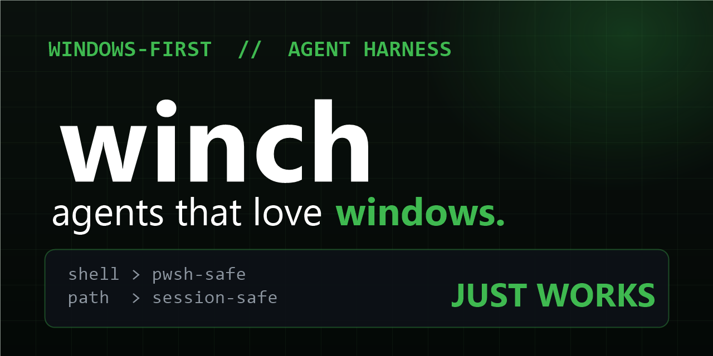

# Winch — coding agents that love Windows



[](LICENSE)
[](https://github.com/Figo-star/winch/stargazers)
[](https://github.com/Figo-star/winch/commits/master)

Every AI harness assumes macOS/Linux. Then it meets PowerShell 5.1, `Start-Process` quoting bugs, per-session `PATH`, and localhost OAuth callbacks — and falls over. Winch is a skill + field guide + doctor CLI distilled from real Windows agent failures, so your coding agent works here first try.

## The 30-second version

- **`SKILL.md`** — Windows operator rules for agents: pwsh 5.1 vs 7, quoting, background processes, PATH, line endings, OneDrive paths. Drop into OpenCode / Claude Code / Codex.
- **`bin/doctor.mjs`** — zero-dep health check: shell version, toolchain (`git`, `gh`, `bun`, `opencode`), git identity, execution policy, long paths. Run it, fix what's red.
- **`docs/`** — five field guides, each one a real incident: [quoting](docs/quoting.md) · [background processes](docs/background-processes.md) · [PATH & env](docs/path-env.md) · [localhost callbacks](docs/localhost-callbacks.md) · [line endings](docs/line-endings.md)

```bash
node bin/doctor.mjs
# WARN  shell powershell 5.1 — quote carefully, see docs/quoting.md
# OK    toolchain git · gh · bun · opencode · winget
# OK    git identity · exec-policy · node v25.7.0
# WARN  long-paths — disabled, keep clones shallow
# winch doctor: OK with 2 warnings
```

## Why this exists

Windows is ~40% of developers and ~5% of harness testing. The failure modes are always the same five (see `docs/`), always misdiagnosed as flaky models, and always fixed with the same small recipes. This repo collects them in one place.

## License

MIT — see [LICENSE](LICENSE).
